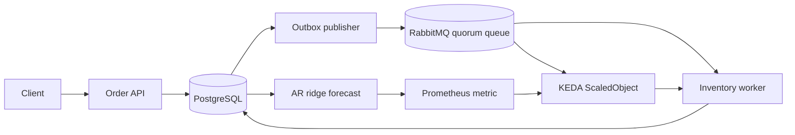

# Resilient AI-Native Microservices — working reference project

This project implements the article's key execution path with ASP.NET Core 10, PostgreSQL, RabbitMQ, a fitted time-series model, Prometheus, and KEDA. The API writes orders and outbox records in one PostgreSQL transaction. The publisher confirms broker delivery before marking an outbox event published. The worker records inbox receipts and inventory state in one transaction, then acknowledges the RabbitMQ delivery. This gives at-least-once delivery with idempotent business effects.


## Architecture


## Run with Docker Compose

```powershell
docker compose up --build -d
./scripts/smoke.ps1
```

The API is at `http://localhost:8080`, RabbitMQ Management at `http://localhost:15672` (`aether` / `aether_dev_only`), and Prometheus at `http://localhost:9090`. Compose starts PostgreSQL, RabbitMQ, the API, the worker, and Prometheus. Volumes preserve broker and database state across restarts.

Try the API directly:

```powershell
$order = Invoke-RestMethod http://localhost:8080/orders -Method Post -ContentType application/json -Body '{"sku":"BOOK-1","quantity":2}'
Invoke-RestMethod "http://localhost:8080/orders/$($order.id)"
Invoke-RestMethod http://localhost:8080/advisor
Invoke-WebRequest http://localhost:8080/metrics
```

## Forecast and scaling

`/advisor` fits an autoregressive ridge regression to the previous 120 complete one-minute order-count buckets. It holds out the newest 20% of the training windows and compares mean absolute error with a last-value baseline. The model is used only when it beats that baseline and at least 10 buckets contain orders. Otherwise the recommendation falls back to the baseline, with no predictive scale signal. The capacity conversion currently assumes 20 orders/minute per worker and a two-minute warm-up horizon; calibrate these against measured service times before production use.

`/metrics` exposes `aether_predicted_backlog`. In Kubernetes, KEDA combines a RabbitMQ queue-length trigger and a Prometheus trigger on that metric in **one** `ScaledObject`; KEDA alone owns the worker HPA. Both triggers are bounded by 1–10 replicas. The fitted model is a real learned numeric model, but its performance and operational benefit have not been established on a real workload.

You can test the model without Docker:

```powershell
dotnet run --project Aether.Api -- --forecast-self-test
```

## Kubernetes and KEDA (local kind cluster)

Install KEDA in the cluster using its official Helm chart, then run:

```powershell
docker build -t aether-api:local .
kind load docker-image aether-api:local
kubectl apply -f k8s/demo.yaml
kubectl -n aether-demo rollout status deployment/aether-api
kubectl -n aether-demo rollout status deployment/inventory-worker
kubectl -n aether-demo port-forward service/aether-api 8080:8080
```

Run `./scripts/smoke.ps1` in another terminal. Inspect scaling with `kubectl -n aether-demo get scaledobject,hpa`. The Kubernetes manifest is for a local demo: it uses local image loading, sample credentials, single-instance PostgreSQL/RabbitMQ, and the cluster's default storage class. Replace those with managed, hardened services and secrets for production.

## Failure behavior and limits

- The publisher uses `FOR UPDATE SKIP LOCKED` so multiple publisher replicas do not claim the same outbox row concurrently. A crash after broker confirmation but before the database commit can republish an event; the inbox suppresses duplicate effects.
- The queue is durable and uses a delivery limit with a dead-letter queue. Invalid payloads are rejected. Transient consumer failures are requeued.
- A database outage prevents readiness; the publisher and consumer reconnect after broker failures. `/health` is liveness and `/ready` checks database access.
- The sample models inventory reservation as an order-state change. It does not integrate a payment gateway, real stock ledger, or autonomous cluster mutation.

Source article: [Designing Resilient AI-Native Microservices](https://medium.com/@erkinemreyilmaz/designing-resilient-ai-native-microservices-from-event-driven-messaging-to-predictive-kubernetes-af87856edf2b).

